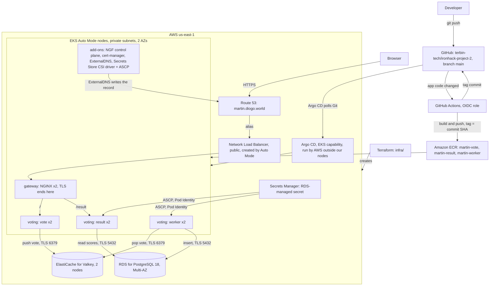

<!-- © 2024 | Ironhack -->

# Voting app on Amazon EKS with GitOps

This repository deploys the course's multi-stack voting app (vote in Python, result in Node.js, worker in .NET, a Redis-compatible queue and PostgreSQL) on **Amazon EKS Auto Mode**. Every AWS resource is declared in **Terraform**, and everything inside the cluster is synced from this Git repository by **Argo CD**, run by AWS as the [EKS capability for Argo CD](https://docs.aws.amazon.com/eks/latest/userguide/argocd.html).

- Vote: <https://martin.diogo.world/>
- Result: <https://martin.diogo.world/result/>

Both are served over HTTPS with a Let's Encrypt certificate that renews by itself, and plain HTTP redirects to HTTPS. Ironhack Project 2, "Deploy a 3-Tier App on Amazon EKS Cluster", for presentation on 27 Oct 2026.

## Contents

- [Architecture](#architecture)
- [Repository layout](#repository-layout)
- [Prerequisites](#prerequisites)
- [Deploy](#deploy)
- [How a change reaches the cluster](#how-a-change-reaches-the-cluster)
- [Run it locally](#run-it-locally)
- [Validation](#validation)
- [Deviations from the brief](#deviations-from-the-brief)
- [What changed during the build](#what-changed-during-the-build)
- [How "scalable" is met](#how-scalable-is-met)
- [What Argo CD does not reconcile](#what-argo-cd-does-not-reconcile)
- [Security](#security)
- [Password rotation](#password-rotation)
- [Known gaps](#known-gaps)
- [Teardown](#teardown)
- [The app](#the-app)
- [Credits](#credits)

## Architecture



**Request path:** browser, `martin.diogo.world` (a Route 53 alias), the NLB (TCP 80 and 443, IP targets), NGINX in the `gateway` namespace (TLS ends here, with the cert-manager certificate), an `HTTPRoute` in `voting`, the vote or result Service, the pods.

**Vote path:** vote pushes the vote onto the `votes` list in Valkey; the worker pops it and writes it to the `votes` table in RDS; result polls RDS every second and pushes the scores to the browser over Socket.IO at `/result/socket.io`.

The setup has three layers:

1. **Terraform** (`infra/`), applied after its plan is reviewed:
   - `infra/bootstrap`: the S3 bucket that holds the other roots' state.
   - `infra/main`: the VPC (two availability zones, one NAT gateway in each), the EKS Auto Mode cluster `martin-project-2` (Kubernetes 1.37), the Argo CD capability and its IAM role, the Secrets Store CSI driver add-on (ASCP), RDS, Valkey, the ECR repositories, the IAM roles and the Pod Identity associations.
   - `infra/gitops-bridge`: the few objects Terraform has to fill in before Argo CD can start (the [GitOps Bridge](https://github.com/gitops-bridge-dev/gitops-bridge) pattern): the Argo CD cluster Secret, `argocd-cm`, the `project-2` AppProject, the root Application, the `voting` namespace with its Pod Security labels, the `voting-config` ConfigMap (database and Valkey endpoints) and the `voting-db` SecretProviderClass.
2. **GitOps, platform** (`gitops/root/`, an [app of apps](https://argo-cd.readthedocs.io/en/stable/operator-manual/cluster-bootstrapping/)): the Gateway API CRDs, NGINX Gateway Fabric, cert-manager and ExternalDNS, each pinned to an exact version, and the `gateway` Application (the Gateway, the HTTP to HTTPS redirect and the ClusterIssuers), all ordered by sync waves.
3. **GitOps, apps** (`gitops/apps/voting/`, Kustomize): the Deployments, Services, ServiceAccounts, HTTPRoutes, NetworkPolicies, PodDisruptionBudgets and the ConfigMap that turns network policy on.

Every Application has automated sync with prune and self heal, so a manual change to a Kubernetes object is undone.

## Repository layout

```
infra/
  bootstrap/        S3 state bucket (its own state stays local and git-ignored)
  main/             VPC, EKS Auto Mode, Argo CD capability, RDS, Valkey, ECR, IAM, Pod Identity, ASCP add-on
  gitops-bridge/    cluster Secret, argocd-cm, AppProject, root Application, voting namespace, voting-config, voting-db
gitops/
  root/             the Argo CD Applications the root Application watches
  gateway/          gateway namespace, Gateway, HTTPS redirect, ClusterIssuers
  apps/voting/      Kustomize: the three apps, routes, network policies
.github/workflows/  ci.yml (checks), deploy.yml (images and tag commits)
vote/ result/ worker/
docker-compose.yml  builds the three apps from source
```

## Prerequisites

- **Tools:** AWS CLI v2, `kubectl` (within one minor version of the cluster's 1.37), Terraform 1.17, Docker with Compose, and the GitHub CLI (`gh`). This build used AWS CLI 2.38.5, kubectl 1.37.1, Terraform 1.17.0, Docker Compose 5.6.1 and gh 2.103.0.
- **AWS identity:** an IAM identity with administrator access. `infra/main/cluster.tf` gives cluster admin to the IAM user named there.
- **Identity Center user:** create the user `martin-project-2` in IAM Identity Center (console, [add users](https://docs.aws.amazon.com/singlesignon/latest/userguide/addusers.html)) before the first apply of `infra/main`. Terraform reads its ID and maps it to Argo CD's `ADMIN` role. It gets no permission set and no account assignment.
- **GitHub OIDC provider:** the account must already have the IAM OIDC provider for `token.actions.githubusercontent.com`. It is shared with other projects in the account, so Terraform only reads it and never creates or changes it.
- **`infra/main/terraform.tfvars`:** copy `infra/main/terraform.tfvars.example` and put your own public IP in `api_allowed_cidrs`. These are the CIDRs allowed to reach the cluster's public API endpoint. The file is git-ignored, so the author's IP is not in this public repository; the endpoint CIDRs are supplied at apply time, not stored in Git.

This code is written for one account. Its account-specific values are the state bucket name (`infra/bootstrap/main.tf`, each root's backend block and the remote state block in `infra/gitops-bridge/versions.tf`), the cluster name that `infra/gitops-bridge/versions.tf` repeats in its provider block, the repository URL of this fork (`infra/gitops-bridge/main.tf`, `gitops/root/gateway.yaml`, `gitops/root/voting.yaml`), the IAM user (`infra/main/cluster.tf`), the hosted zone and DNS names (`infra/main/iam.tf`, `gitops/root/external-dns.yaml`, `gitops/gateway/`, `gitops/apps/voting/routes.yaml`), the GitHub subject (`infra/main/iam.tf`) and the registry and role (`.github/workflows/deploy.yml`, `gitops/apps/voting/kustomization.yaml`).

## Deploy

These are the commands this build ran, in order. A Terraform plan is read before every apply.

### 1. State bucket

`infra/bootstrap` creates the S3 bucket for the other roots' state. It keeps its own state locally (`infra/bootstrap/terraform.tfstate`), which is git-ignored, because the bucket cannot hold the state of the root that creates it.

```bash
terraform -chdir=infra/bootstrap init
terraform -chdir=infra/bootstrap plan -out=tfplan
terraform -chdir=infra/bootstrap apply tfplan
```

The plan adds 3 resources: the bucket, its versioning and its public access block. The other roots use it with S3 native state locking (`use_lockfile`, see the [S3 backend docs](https://developer.hashicorp.com/terraform/language/backend/s3)).

### 2. Cluster, data tier and registry

```bash
cp infra/main/terraform.tfvars.example infra/main/terraform.tfvars
curl -s https://checkip.amazonaws.com          # your IP; put it in terraform.tfvars as "<ip>/32"
terraform -chdir=infra/main init -reconfigure
terraform -chdir=infra/main plan -out=tfplan
terraform -chdir=infra/main apply tfplan
```

The plan adds 65 resources. The apply took about 12 minutes; the Multi-AZ RDS instance is the slowest part.

```bash
aws eks update-kubeconfig --name martin-project-2 --region us-east-1
kubectl get nodes
kubectl get crd applications.argoproj.io appprojects.argoproj.io secretproviderclasses.secrets-store.csi.x-k8s.io
```

`kubectl get nodes` prints `No resources found` at this point: Auto Mode starts a node only when a pod needs one. The three CRDs must exist before the next step, because `infra/gitops-bridge` reads them at plan time.

### 3. Hand the cluster to Argo CD

```bash
terraform -chdir=infra/gitops-bridge init -reconfigure
terraform -chdir=infra/gitops-bridge plan -out=tfplan
terraform -chdir=infra/gitops-bridge apply tfplan
kubectl get applications -n argocd -o custom-columns=NAME:.metadata.name,SYNC:.status.sync.status,HEALTH:.status.health.status
```

The plan adds 7 objects. The root Application then creates the platform Applications, and each one ends `Synced` and `Healthy`. It also creates `voting`, whose pods stay pending on missing images until step 4 has pushed them. The gateway's Service makes Auto Mode create the NLB; once the gateway's first route exists (the HTTP to HTTPS redirect in `gitops/gateway/`, before any voting route), ExternalDNS writes `martin.diogo.world` and cert-manager gets the certificate through the gateway.

The Argo CD UI address comes from Terraform; sign in as the Identity Center user:

```bash
terraform -chdir=infra/main output argocd_server_url
```

### 4. First images

The ECR repositories start empty, so the deploy workflow is started once by hand. It builds all three images, pushes them to ECR and records their tags in Git.

```bash
gh workflow run deploy.yml -R terbin-tech/ironhack-project-2 --ref main
gh run watch <run-id> -R terbin-tech/ironhack-project-2 --exit-status
git pull --rebase
```

`gh run list -R terbin-tech/ironhack-project-2 --workflow deploy.yml` shows the run ID. After the pull, `gitops/apps/voting/kustomization.yaml` carries the new commit SHA as `newTag` for each service, and Argo CD rolls the apps out.

## How a change reaches the cluster

1. You push a change under `vote/`, `result/` or `worker/` to `main`.
2. `deploy.yml` works out which services changed, logs in to AWS with GitHub's OIDC token (no stored AWS keys), builds each changed image for `linux/amd64` and pushes it to ECR tagged with the full commit SHA. If that tag already exists, it skips the build.
3. Its last job sets the new `newTag` values in `gitops/apps/voting/kustomization.yaml` and commits them to `main` through GitHub's GraphQL `createCommitOnBranch`, so GitHub signs the commit.
4. Argo CD sees the new commit on its next poll and rolls out the new image. Nothing outside AWS holds credentials to the cluster.

`ci.yml` runs on every push and pull request except the deploy workflow's own tag commits: they are pushed with the `GITHUB_TOKEN`, and GitHub starts no workflow run from events that token causes ([triggering a workflow from a workflow](https://docs.github.com/en/actions/how-tos/write-workflows/choose-when-workflows-run/trigger-a-workflow#triggering-a-workflow-from-a-workflow)). It runs `terraform fmt` and `validate` for each root, `kubectl kustomize` of the apps, and hadolint on the three Dockerfiles.

**Pull before you push.** Every deploy adds a tag commit to `main`, so run `git pull --rebase` before pushing. The `main` ruleset blocks force pushes.

In this build, a push that changed only `result/` built only result, its tag commit was signed (`verification.verified: true`), and Argo CD rolled it out with no manual step.

## Run it locally

Compose builds the three apps from this repository's source and runs plain Redis and Postgres next to them. TLS and the secret files are off by default, so the same code runs locally and on EKS.

Create a file named `.env` next to `docker-compose.yml` with one line, `DB_PASSWORD=` followed by a password of your choice. It is git-ignored; do not commit it. To change the password later, run `docker compose down -v` first.

```bash
docker compose up --build
```

Vote at <http://localhost:8080> and see the results at <http://localhost:8081/result/>.

## Validation

How the brief's validation steps map to this design. There is no Ingress, an NLB has a DNS name rather than one IP, and the listeners are bound to the hostname.

| Brief | Here | Command or check |
|---|---|---|
| `kubectl get deployments`, `kubectl get pods` | The three Deployments and six pods in `voting` | `kubectl get deploy,pods -n voting` |
| `kubectl get ingress` showing an external IP | The Gateway; its ADDRESS is the NLB's DNS name | `kubectl get gateway -n gateway` and `kubectl get httproute -n voting` |
| `http://<INGRESS_IP>/vote` | The vote page over HTTPS | <https://martin.diogo.world/> (also `/vote`) |
| `http://<INGRESS_IP>/result` | The result page over HTTPS, updating live | <https://martin.diogo.world/result/> |
| "Verify the service DNS in your browser" | ExternalDNS writes `martin.diogo.world`; HTTP redirects to HTTPS | `curl -I http://martin.diogo.world/` shows `301` with `Location: https://martin.diogo.world/` |

More checks this build ran:

```bash
kubectl get applications -n argocd -o custom-columns=NAME:.metadata.name,SYNC:.status.sync.status,HEALTH:.status.health.status
curl -sI https://martin.diogo.world/                                  # HTTP/2 200, trusted certificate, no -k
curl -s https://martin.diogo.world/vote | grep -c 'name="vote"'       # 2
curl -sI https://martin.diogo.world/result                            # 301 to /result/
```

The live update was also checked in a browser: with two windows open, a vote showed on the result page at once, and the network tab listed `/result/socket.io/?EIO=4&transport=websocket` with status `101`. Scaling the worker to zero by hand was undone by Argo CD's self heal within 7 seconds, and the votes cast meanwhile were processed when the new worker started.

## Deviations from the brief

| Brief says | This repo | Why, with source |
|---|---|---|
| Install the NGINX Ingress Controller with Helm and use an `Ingress` with the `kubernetes.io/ingress.class: "nginx"` annotation | NGINX Gateway Fabric with the Gateway API (`GatewayClass`, `Gateway`, `HTTPRoute`), still NGINX and still a Helm chart | ingress-nginx is retired and its repository archived, and Kubernetes recommends Gateway API: [retirement post](https://kubernetes.io/blog/2025/11/11/ingress-nginx-retirement/), [Ingress controllers](https://kubernetes.io/docs/concepts/services-networking/ingress-controllers/) (the Ingress API "has been frozen"), [ingress-nginx](https://github.com/kubernetes/ingress-nginx). The annotation itself was replaced by `spec.ingressClassName` long ago. |
| Deploy Redis and Postgres "to the cluster (as Deployments)" | Amazon ElastiCache for Valkey (Multi-AZ replication group) and Amazon RDS for PostgreSQL Multi-AZ, created by Terraform | AWS runs backups, patching and cross-zone failover. |
| vote, result and worker each with a Deployment and a Service | vote and result have Services; the worker has none | The worker listens on no port, so a Service would select nothing useful. |
| GitHub Actions deploys with `kubectl apply -f K8s/` | GitHub Actions builds, pushes and records the image tag in Git; Argo CD pulls and applies | [OpenGitOps](https://opengitops.dev/) principle "Pulled Automatically"; no cluster credentials outside AWS, and the Kubernetes API stays restricted. |
| `aws-actions/configure-aws-credentials@v1` with access key secrets | `configure-aws-credentials` v6.3.0 pinned to its commit SHA, with `role-to-assume` over OIDC | Short-lived credentials and no stored keys: [GitHub OIDC in AWS](https://docs.github.com/en/actions/how-tos/secure-your-work/security-harden-deployments/oidc-in-aws). |
| `eksctl utils write-kubeconfig` and `kubectl` in the pipeline | No kubeconfig in the pipeline; people use `aws eks update-kubeconfig` | Pull model, so the pipeline never touches the cluster. eksctl is not needed anywhere. |
| Push images to "your container registry (e.g., Docker Hub)" | Amazon ECR, tags immutable, scan on push | The brief's "e.g." allows it: one AWS login for build and deploy, and no registry password in GitHub. |
| Region `eu-west-3` and the cluster `romain-voting-app-cluster` | us-east-1, every AWS resource Terraform creates prefixed `martin-` | The class shares one AWS account, so every AWS resource Terraform creates carries the owner's prefix and the tag `Owner = martin`. The load balancer, the nodes and their parts are created by EKS Auto Mode and named by it. |
| Service names like `redis-service`, `vote-service`; manifests in `K8s/` | Plain Service names `vote` and `result`; the layout above | In-cluster callers still use Service names, and the apps reach RDS and Valkey by their AWS DNS names, never by IP. |
| `kubectl create secret generic db-credentials --from-literal=...` | RDS generates and keeps the password in Secrets Manager; ASCP delivers it only to result and worker | No password is typed, logged or stored in Git, and only the result and worker pods can read the one secret: [EKS secrets](https://docs.aws.amazon.com/eks/latest/userguide/manage-secrets.html), [ASCP with Pod Identity](https://docs.aws.amazon.com/secretsmanager/latest/userguide/ascp-pod-identity-integration.html). |
| Ingress add-on routes `/vote` and `/result` over plain HTTP | The same paths over HTTPS on `martin.diogo.world`; `/vote` is served through the `/` route; HTTP redirects to HTTPS | The brief's HTTPS add-on, done with [cert-manager and Gateway API](https://cert-manager.io/docs/usage/gateway/) using the [HTTP-01 challenge](https://cert-manager.io/docs/configuration/acme/http01/); the brief's Route 53 records are written by [ExternalDNS](https://kubernetes-sigs.github.io/external-dns/latest/docs/tutorials/aws/). |
| Validation with `kubectl get ingress` and `http://<INGRESS_IP>/...` | The commands in [Validation](#validation) | No Ingress exists, and an NLB has a DNS name rather than one IP. |

## What changed during the build

### Departures from the design

- **Worker health checks.** The worker listens on no port, so it writes a heartbeat file (`/tmp/heartbeat`, at most every 5 seconds) from its main loop and from its two retry loops, and its readiness and liveness probes are exec checks that the file is less than 30 seconds old ([exec probes](https://kubernetes.io/docs/tasks/configure-pod-container/configure-liveness-readiness-startup-probes/)). Writing from the retry loops means a database or Valkey outage does not restart the pod; the probe catches only a worker that stopped making progress. Compose uses the same check. No official source names a standard for workers without a port, so this follows the documented exec pattern rather than a named best practice.
- **Worker Postgres timeouts.** The worker's connection uses `Timeout = 5`, `CommandTimeout = 10` and GSS encryption off, so a hung database cannot block it long enough to fail the probe.
- **Two workers.** The worker takes each vote off the `votes` list with a single atomic pop and stores it as a new row (the default `every-click` mode), so two workers never take the same vote and the order they store in does not change the counts. They run one per zone, like vote and result, with the default rolling update and a PodDisruptionBudget, so losing a zone leaves one worker processing votes. A worker that stops after taking a vote and before storing it loses that vote; a reliable queue that moves each vote to a processing list until it is stored ([Valkey: reliable queue](https://valkey.io/commands/rpoplpush/)) is not built.
- **Valkey certificate revocation checking off on the worker.** The worker's Valkey connection sets `checkCertificateRevocation=false`. Its Redis client checks revocation online by default, and the network policies allow only DNS, 6379 and 5432 out, so that check could not reach the certificate authority. The certificate chain and the hostname are still verified.
- **result reads the database username once and the password per connection.** node-postgres takes the user only as a string and the password as a function; RDS rotation changes only the password, so the username never goes stale.
- **The Node 24 bump landed at the pipeline milestone** (from `node:18-slim` to `node:24-slim`), as the push-triggered deploy test: a real one-service change instead of an invented one.

### Changes the build found necessary

- **`sourceNamespaces` on the AppProject.** Every custom AppProject on the EKS Argo CD capability needs `sourceNamespaces`. Without it the root Application stayed `Unknown` ("not permitted to use project"). See [Working with Argo CD Projects](https://docs.aws.amazon.com/eks/latest/userguide/argocd-projects.html): the field "is required in your custom AppProject definition".
- **Server-side diff.** The Applications in `gitops/root/` use Argo CD's [server-side diff](https://argo-cd.readthedocs.io/en/stable/user-guide/diff-strategies/) (`argocd.argoproj.io/compare-options: ServerSideDiff=true`), because the API server's defaults on HTTPRoutes kept the app `OutOfSync` under the legacy diff. The root Application, created by `infra/gitops-bridge`, keeps the legacy diff.
- **Cross-zone load balancing on the NLB.** The gateway's NLB has cross-zone load balancing on. The first Let's Encrypt challenge timed out: the NLB balanced only within each zone, both NGINX pods ran in one zone, and while the port 443 targets waited for a certificate, DNS also returned the other zone's address, which had no target. Turning cross-zone load balancing on fixed it. The setting is an annotation on the Gateway's infrastructure, as the [Auto Mode NLB guide](https://docs.aws.amazon.com/eks/latest/userguide/auto-configure-nlb.html) shows; see also [NLB cross-zone behaviour](https://docs.aws.amazon.com/elasticloadbalancing/latest/network/network-load-balancers.html).

## How "scalable" is met

EKS Auto Mode adds and removes nodes as pods need them ([Auto Mode](https://docs.aws.amazon.com/eks/latest/userguide/automode.html)); after the apps were deployed, Auto Mode had started one `c6a.large` node (checked before the resource requests and limits were added). Replica counts are fixed: vote and result run two replicas each with a PodDisruptionBudget, NGINX runs two, and the worker runs two. vote, result, the worker and NGINX each place one replica per availability zone with a [topology spread constraint](https://kubernetes.io/docs/concepts/scheduling-eviction/topology-spread-constraints/) (`DoNotSchedule`, `minDomains: 2`), so Auto Mode runs a node in each zone and a zone outage leaves one replica of each serving. There is no horizontal pod autoscaling; it is out of scope, as are an observability stack and a service mesh.

## What Argo CD does not reconcile

Everything else in the cluster comes from Git. These exceptions are on purpose and visible:

- **The bridge's hand-off objects and the ASCP add-on** are owned by Terraform (`infra/gitops-bridge`, `infra/main`). Drift shows in `terraform plan`, not in Argo CD's self heal.
- **The nodes and the NLB** are AWS resources that EKS Auto Mode manages.
- **The DNS records** for `martin.diogo.world` are written by ExternalDNS from the HTTPRoutes declared in Git.
- **The Identity Center user** is a documented manual step.
- **GuardDuty's agent** (`aws-guardduty-agent` in `amazon-guardduty`) landed on the cluster through the account's GuardDuty policy, not from Git.

For AWS resources, `terraform plan` showing no changes is the drift check.

## Security

- **No long-lived credentials outside AWS.** The pipeline uses OIDC, people use their IAM identity, Argo CD runs under its capability role, and pods use [EKS Pod Identity](https://docs.aws.amazon.com/eks/latest/userguide/pod-identities.html).
- **Least privilege per actor.** The pipeline role can push only to the three repositories. ExternalDNS may change only `martin.diogo.world` and its two TXT ownership names in the one hosted zone. The pods' role reads only the one database secret. Both Pod Identity roles trust only their own namespace, service accounts and cluster. cert-manager needs no AWS permissions. Argo CD has cluster admin inside the cluster, bounded by the AppProject to this repo, the pinned upstream chart and CRD sources, and this cluster.
- **Restricted API endpoint.** The public endpoint accepts only the CIDRs in `terraform.tfvars`, and the private endpoint is on ([cluster endpoint](https://docs.aws.amazon.com/eks/latest/userguide/cluster-endpoint.html)). So `kubectl`, and the teardown steps that use it (the Argo CD deletions and the `infra/gitops-bridge` destroy), work only from an address listed in that file. From any other address, first put the current one in `terraform.tfvars` and apply `infra/main`; the plan should show only the change to the endpoint's CIDRs.
- **TLS** from the browser to the gateway, and from the apps to RDS and Valkey with certificate verification ([RDS SSL](https://docs.aws.amazon.com/AmazonRDS/latest/UserGuide/PostgreSQL.Concepts.General.SSL.html), [ElastiCache in-transit encryption](https://docs.aws.amazon.com/AmazonElastiCache/latest/dg/in-transit-encryption.html)). Inside the cluster, gateway to pods is plain HTTP.
- **Encryption at rest** on RDS and Valkey; Kubernetes Secrets use EKS's default envelope encryption.
- **Workload hardening** in `voting`: [Pod Security](https://kubernetes.io/docs/concepts/security/pod-security-standards/) `restricted`, non-root containers with all capabilities dropped and read-only root filesystems, resource requests and limits, and default-deny [network policies](https://docs.aws.amazon.com/eks/latest/userguide/auto-net-pol.html) with explicit allows (gateway to vote and result on 80; DNS; vote and worker to Valkey; worker and result to Postgres).
- **Supply chain.** Images are tagged with the commit SHA and immutable in ECR. Every GitHub Action is pinned to a full commit SHA, and the repository requires it.
- The repository is public and holds no secret. Push access to `main` controls what runs in the cluster.

## Password rotation

Rotation is on: RDS keeps the database password in Secrets Manager and rotates it every seven days by default ([RDS and Secrets Manager](https://docs.aws.amazon.com/AmazonRDS/latest/UserGuide/rds-secrets-manager.html)).

- The Secrets Store CSI driver add-on runs with `enableSecretRotation: true`, so it refreshes the mounted `username` and `password` files every 2 minutes.
- result and worker read the password from the mounted file each time they open a database connection (result through node-postgres's [password callback](https://node-postgres.com/features/connecting)), so a rotation needs no restart.
- The driver's rotation reconciler is marked alpha upstream ([secret auto rotation](https://secrets-store-csi-driver.sigs.k8s.io/topics/secret-auto-rotation)), and it is the path AWS's EKS docs point to: "If you use Secrets Manager automatic rotation for your secrets, you can also use the Secrets Store CSI Driver rotation reconciler feature" ([EKS secrets](https://docs.aws.amazon.com/eks/latest/userguide/manage-secrets.html)).

Tested in this build: a forced rotation (`aws rds modify-db-instance --db-instance-identifier martin-project-2 --rotate-master-user-password --apply-immediately`) reached the pods' files 92 seconds after the new secret version became current. A database reboot then dropped every connection; the worker reconnected with the new password, votes kept being processed, and no pod restarted.

## Known gaps

- **Argo CD polls Git instead of using a webhook.** The [EKS docs](https://docs.aws.amazon.com/eks/latest/userguide/argocd-considerations.html) give a 6-minute poll by default; in the one push-triggered run measured here, Argo CD picked up a tag commit about 13.5 minutes after it landed. For Argo CD to verify that a webhook payload came from GitHub, the same page has a shared secret stored in the `argocd-webhook-creds-secret` Secret in the cluster, outside Git, so polling stays.
- **Re-run only the newest deploy run.** By the workflow's logic, re-running an older run would write its older tag back to `kustomization.yaml`, and Argo CD would then roll that service back.
- **No image scan counts.** The account's registry uses Amazon Inspector enhanced scanning, which overrides the repositories' scan on push, and Inspector did not cover these ECR repositories, so no critical or high counts were available.
- **vote's memory limit.** The vote image runs 4 gunicorn workers under a 256Mi memory limit; watch it for `OOMKilled` restarts.
- **No Valkey AUTH.** Access to the cache is controlled by security group, network policy and TLS.

## Teardown

Teardown works on the cluster and in Terraform; the manifests and tag commits stay in Git. Note the gateway's address first (`kubectl get gateway -n gateway`).

1. Stop the root Application's auto-sync, so nothing recreates the children deleted next:

   ```bash
   kubectl patch application root -n argocd --type json -p '[{"op":"remove","path":"/spec/syncPolicy/automated"}]'
   ```

2. Delete the apps, then the gateway. Wait until the NLB is gone and ExternalDNS (still running) has removed `martin.diogo.world` and its TXT records; both checks print `[]`:

   ```bash
   kubectl delete application voting -n argocd --wait --timeout=10m
   kubectl delete application gateway -n argocd --wait --timeout=10m
   aws elbv2 describe-load-balancers --query "LoadBalancers[?DNSName=='<gateway address>']"
   aws route53 list-resource-record-sets --hosted-zone-id Z06626683QXS56B0ODY18 --query "ResourceRecordSets[?contains(Name,'martin.diogo.world')]"
   ```

3. Delete the platform Applications. Each carries Argo CD's resources finalizer, so each deletion cascades:

   ```bash
   kubectl delete application external-dns cert-manager nginx-gateway-fabric gateway-api-crds -n argocd --wait --timeout=10m
   ```

4. Destroy the bridge, then the main root (RDS, Valkey, ECR with its images, IAM roles, the capability, the cluster, the VPC). Multi-AZ RDS deletion takes several minutes. The AWS provider removes the GuardDuty-managed VPC endpoint and security group on destroy ([GuardDuty and IaC](https://docs.aws.amazon.com/guardduty/latest/ug/using-iac-with-gdu-automated-agents-runtime-monitoring.html)).

   ```bash
   terraform -chdir=infra/gitops-bridge plan -destroy -out=tfplan
   terraform -chdir=infra/gitops-bridge apply tfplan
   terraform -chdir=infra/main plan -destroy -out=tfplan
   terraform -chdir=infra/main apply tfplan
   ```

   If the VPC destroy is blocked, list what is left in the VPC and delete each blocker by its ID (never a security group by `--group-name`), then re-run the destroy:

   ```bash
   aws ec2 describe-vpc-endpoints --filters Name=vpc-id,Values=<vpc_id>
   aws ec2 describe-security-groups --filters Name=vpc-id,Values=<vpc_id>
   aws ec2 describe-network-interfaces --include-managed-resources --filters Name=vpc-id,Values=<vpc_id>
   ```

5. Destroy the state bucket. `force_destroy` empties every object version; the last command then returns `404`:

   ```bash
   terraform -chdir=infra/bootstrap plan -destroy -out=tfplan
   terraform -chdir=infra/bootstrap apply tfplan
   aws s3api head-bucket --bucket martin-tfstate-686699774218-us-east-1
   ```

6. Delete the Identity Center user, by the ID looked up from its exact user name:

   ```bash
   aws identitystore get-user-id --identity-store-id <identity store ID> --alternate-identifier '{"UniqueAttribute":{"AttributePath":"userName","AttributeValue":"martin-project-2"}}'
   aws identitystore delete-user --identity-store-id <identity store ID> --user-id <user ID>
   ```

7. Check that nothing remains. Each prints an empty result, `{"ResourceTagMappingList": []}`:

   ```bash
   aws resourcegroupstaggingapi get-resources --tag-filters Key=Owner,Values=martin
   aws resourcegroupstaggingapi get-resources --tag-filters Key=eks:eks-cluster-name,Values=martin-project-2
   ```

   Also check, with `--include-managed-resources` and the cluster tag filter where they apply: EC2 instances, launch templates, network interfaces, volumes and security groups; the Auto Mode instance profile; RDS snapshots and automated backups; ElastiCache snapshots; the RDS-managed secret; the CloudWatch log group `/aws/eks/martin-project-2/`; IAM roles and policies starting `martin-`; the three Route 53 names; and the Identity Center applications.

   If the Auto Mode instance profile is left, list it and delete it by its exact name:

   ```bash
   aws iam list-instance-profiles --query "InstanceProfiles[?contains(InstanceProfileName,'martin-project-2')].InstanceProfileName"
   aws iam delete-instance-profile --instance-profile-name <name>
   ```

## The app

This section is the course's original description of the app.

**Welcome to your DevOps practice project!** This repository hosts a multi-stack voting application composed of several services, each implemented in a different language and technology stack. The goal is to help you gain experience with containerization, orchestration, and running a distributed set of services, both individually and as part of a unified system.

This application, while simple, uses multiple components commonly found in modern distributed architectures, giving you hands-on practice in connecting services, handling containers, and working with basic infrastructure automation.

### Application Overview

The voting application includes:

- **Vote (Python)**: A Python Flask-based web application where users can vote between two options.
- **Redis (in-memory queue)**: Collects incoming votes and temporarily stores them.
- **Worker (.NET)**: A .NET 10-based service that consumes votes from Redis and persists them into a database.
- **Postgres (Database)**: Stores votes for long-term persistence.
- **Result (Node.js)**: A Node.js/Express web application that displays the vote counts in real time.

### Why This Setup?

The goal is to introduce you to a variety of languages, tools, and frameworks in one place. This is **not** a perfect production design. Instead, it’s intentionally diverse to help you:

- Work with multiple runtimes and languages (Python, Node.js, .NET).
- Interact with services like Redis and Postgres.
- Containerize applications using Docker.
- Use Docker Compose to orchestrate and manage multiple services together.

By dealing with this “messy” environment, you’ll build real-world problem-solving skills. After this project, you should feel more confident tackling more complex deployments and troubleshooting issues in containerized, multi-service setups.

## Credits

- The voting app: [Pokfinner/ironhack-project-1](https://github.com/Pokfinner/ironhack-project-1), which this repository is forked from.
- The Terraform is modeled on [professordiogodev/eks-quick-terraform](https://github.com/professordiogodev/eks-quick-terraform) (its VPC and EKS modules and provider pins), with remote state, a restricted API endpoint and an explicit admin access entry added.
